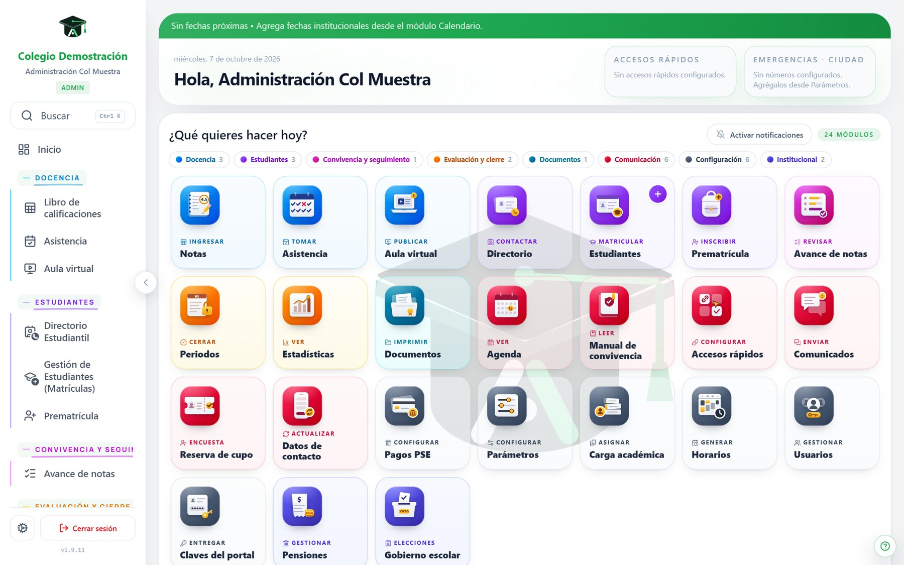
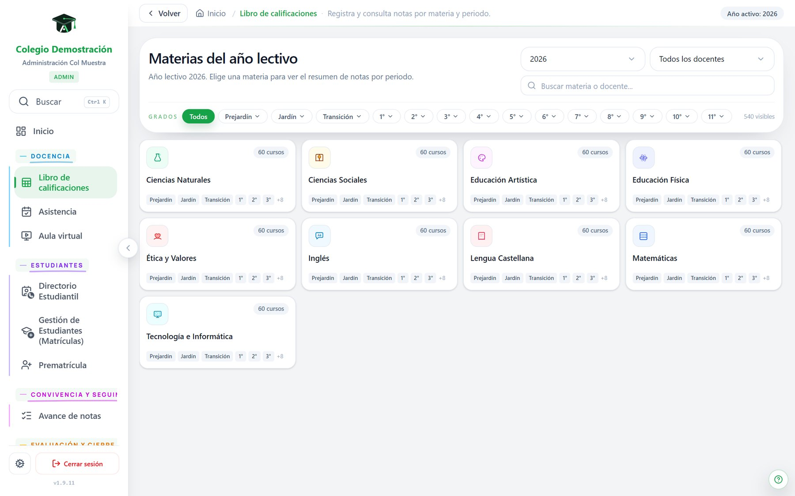
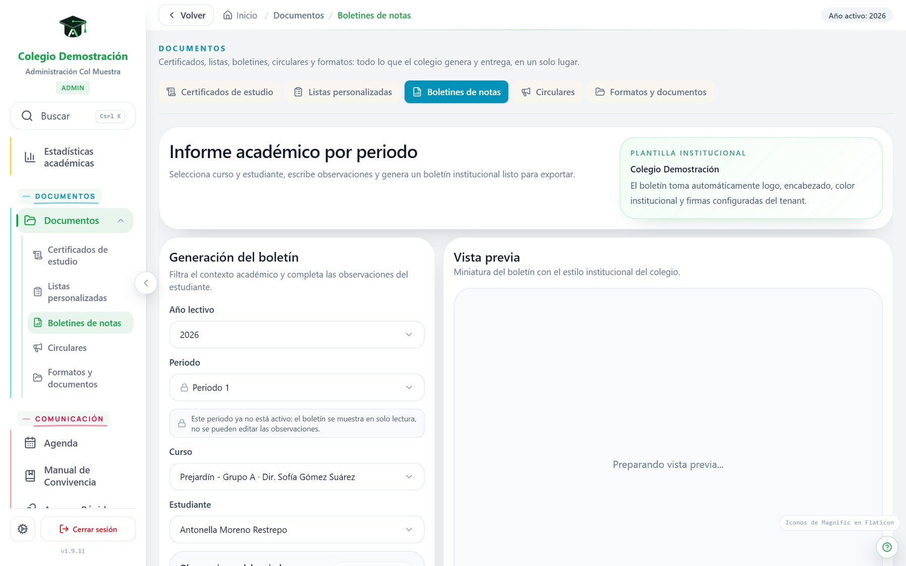
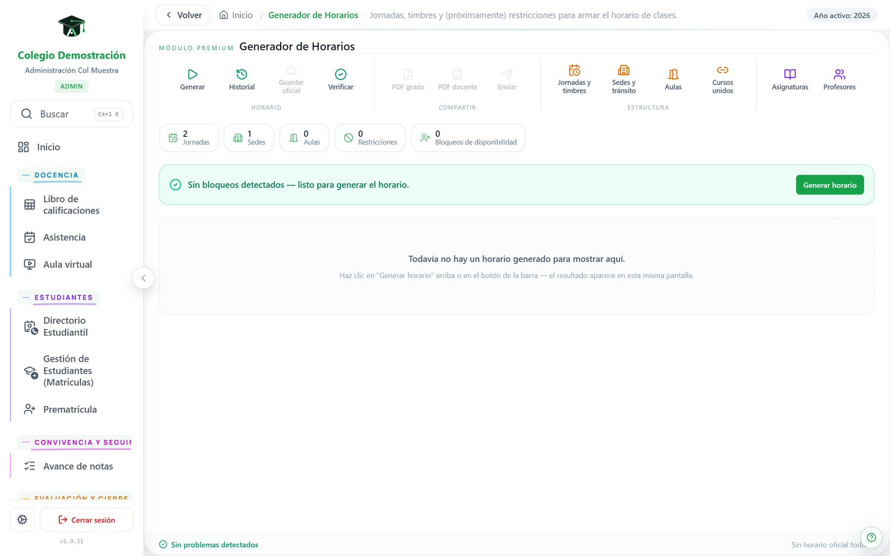

  <picture>
    <source media="(prefers-color-scheme: dark)" srcset="assets/marca/logo-dark.svg">
    
  </picture>

<strong>Todo el colegio, en un solo lugar.</strong>

# SistemAcadémico — documentación y avances

Este repositorio es la **cara pública** de SistemAcadémico, una plataforma digital que reúne la vida
académica, la convivencia, la comunicación con las familias y la administración de un colegio. Aquí
está la documentación del proyecto y el registro de cómo avanza. **El código de la aplicación no está
aquí.**

- Sitio web: <https://sistemacademico.com>
- Contacto: <contacto@sistemacademico.com>
- Autor: Juan Pablo Lugo Barragán (Sopó, Cundinamarca)

## ¿Qué es SistemAcadémico?

Una plataforma pensada para colegios de Colombia que automatiza lo que puede automatizarse, para que
docentes y funcionarios dediquen su tiempo a lo que exige intervención humana. Cada colegio tiene su
propio espacio, aislado de los demás, con sus datos, su marca y sus usuarios.

Hoy está **en producción**: un colegio de Sopó la usa todos los días desde marzo de 2026, y la
plataforma sigue creciendo semana a semana.

## ¿Qué encuentras en este repositorio?

| Documento | Qué contiene |
|-----------|--------------|
| [docs/modulos.md](docs/modulos.md) | Qué hace la plataforma, módulo por módulo |
| [docs/arquitectura.md](docs/arquitectura.md) | Cómo está pensada por dentro, a nivel conceptual |
| [docs/avances.md](docs/avances.md) | Línea de tiempo del desarrollo, mes a mes |
| [docs/privacidad-y-seguridad.md](docs/privacidad-y-seguridad.md) | Cómo se protegen los datos de estudiantes y familias |
| [docs/documento-del-sistema.pdf](docs/documento-del-sistema.pdf) | Documento del sistema: recorrido completo con capturas |
| [assets/capturas](assets/capturas) | Capturas de pantalla del sistema con datos ficticios |

## Un vistazo

| | |
|---|---|
|  |  |
| *Pantalla de inicio, organizada por tareas* | *Libro de calificaciones* |
|  |  |
| *Boletines por periodo* | *Generador de horarios* |

Todas las capturas son del **colegio de demostración**, con datos ficticios. Nunca se publican datos
de un colegio real.

## ¿Por qué el código es privado?

La aplicación guarda información de **menores de edad** (notas, observaciones de convivencia, planes
de inclusión, datos de contacto de las familias). Publicar el código significaría mostrar cómo se
protege y se organiza esa información, y eso no es una buena idea para un sistema que está en uso. Por
eso el código vive en un **repositorio privado**.

Además, SistemAcadémico es un producto en desarrollo que se ofrece a otros colegios, y el código es
parte de ese producto.

Este repositorio existe para que cualquiera pueda **entender qué es el proyecto y ver cómo avanza**
sin que eso comprometa a nadie.

## ¿Quieres conocerla, usarla o colaborar?

Escribe a <contacto@sistemacademico.com>. Si eres de un colegio o de una entidad que quiere ver la
plataforma funcionando, podemos hacer una demostración con datos ficticios.

## Licencia y uso

Todos los derechos reservados © 2026 Juan Pablo Lugo Barragán. Los documentos y las capturas de este
repositorio se pueden leer y citar con atribución, pero no se pueden redistribuir ni reutilizar para
crear productos derivados sin permiso. Ver [LICENSE](LICENSE).
